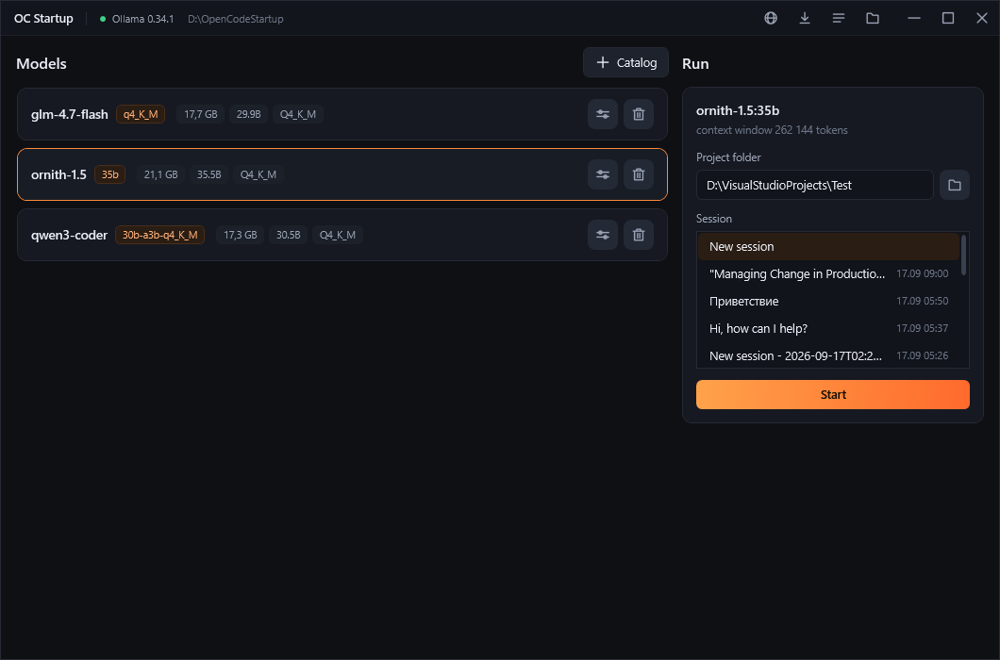

**[English](/README.md)** | **[Русский](/docs/README.ru.md)** | **[中文](/docs/README.zh.md)**

# OC Startup

A Windows launcher for the [OpenCode](https://opencode.ai) desktop app running on a local
[Ollama](https://ollama.com) model. Choose a model, a project folder and a session, press Start -
the launcher configures both programs and opens OpenCode ready to work.



- Local models in one list: download from the Ollama library, delete, see size and quantization.
- Per-model settings: context window, max response and reasoning for OpenCode, plus the Ollama
  parameters themselves.
- The model is loaded into memory and asked a test question first; OpenCode opens only if it answered.
- If the model or Ollama fails, OpenCode is closed and the reason is shown instead of a stuck chat.
- Interface in English, Russian and Chinese - chosen by the system language on first run.

## Install

Requires Windows 10/11 x64 and [Ollama](https://ollama.com/download). The launcher installs OpenCode
on its own.

Download the archive from [Releases](../../releases), unpack it and run `OCStartup.exe` - the build
is self-contained, no .NET required.

## Build

```bash
dotnet build OCStartup.csproj
```
