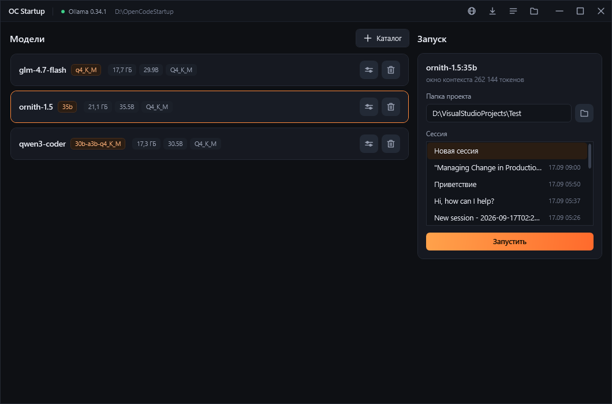

**[English](/README.md)** | **[Русский](/docs/README.ru.md)** | **[中文](/docs/README.zh.md)**

# OC Startup

Программа для Windows, которая запускает приложение [OpenCode](https://opencode.ai) вместе с
локальной моделью [Ollama](https://ollama.com). Выбираете модель, папку проекта и сессию, жмёте
«Запустить» - остальное программа настраивает сама и открывает OpenCode готовым к работе.



- Локальные модели одним списком: скачать из библиотеки Ollama, удалить, посмотреть размер и
  квантование.
- Настройки каждой модели: окно контекста, максимум ответа и рассуждения для OpenCode, а также сами
  параметры Ollama.
- Сначала модель грузится в память и отвечает на пробный вопрос, и только потом открывается OpenCode.
- Если модель или Ollama отказали, OpenCode закрывается и показывает причину, а не висит в чате.
- Интерфейс на английском, русском и китайском - при первом запуске язык берётся из системы.

## Установка

Нужны Windows 10/11 x64 и [Ollama](https://ollama.com/download). OpenCode программа ставит сама.

Скачайте архив из [релизов](../../releases), распакуйте и запустите `OCStartup.exe` - сборка
самодостаточная, .NET не нужен.

## Сборка

```bash
dotnet build DshStudio.csproj
```
