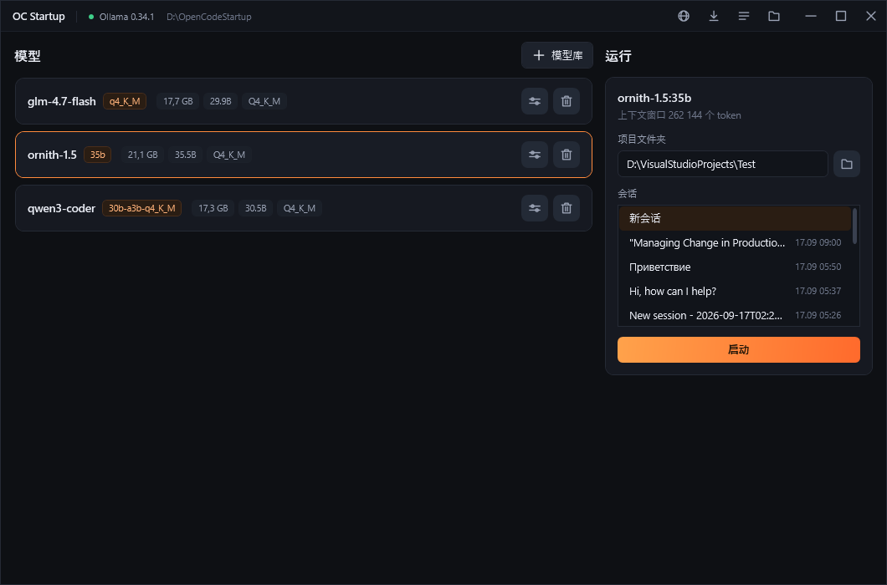

**[English](/README.md)** | **[Русский](/docs/README.ru.md)** | **[中文](/docs/README.zh.md)**

# OC Startup

一个 Windows 启动器，把 [OpenCode](https://opencode.ai) 桌面应用和本地 [Ollama](https://ollama.com)
模型一起启动。选好模型、项目文件夹和会话，按「启动」，其余配置由它完成，打开即可开始工作。



- 本地模型集中在一个列表里：从 Ollama 模型库下载、删除，查看体积和量化方式。
- 每个模型的设置：给 OpenCode 的上下文窗口、最大回复长度和思考开关，以及 Ollama 自身的参数。
- 先把模型装入内存并让它回答一个测试问题，通过之后才打开 OpenCode。
- 模型或 Ollama 出问题时，OpenCode 会关闭并说明原因，而不是让对话卡住。
- 界面支持英文、俄文和中文，首次运行按系统语言选择。

## 安装

需要 Windows 10/11 x64 和 [Ollama](https://ollama.com/download)。OpenCode 由启动器自行安装。

从 [Releases](../../releases) 下载压缩包，解压后运行 `OCStartup.exe` - 自包含构建，无需 .NET。

## 构建

```bash
dotnet build OCStartup.csproj
```
